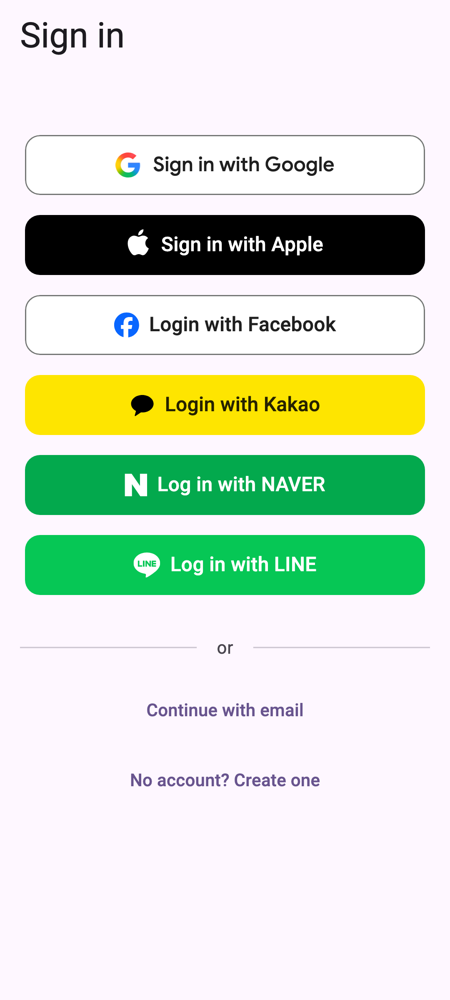

# flutter_starter_kit

Flutter + Firebase 앱을 시작하는 Starter Kit 이다. 인증 · 다국어 · 디자인 시스템 · Firebase 설정 보일러플레이트를 덜어 내고, Feature-First 아키텍처와 코딩 규칙을 프로젝트 시작부터 지키게 한다.

> 이 킷은 사람이 코드를 직접 쓰지 않고, Claude Code 와 대화하는 바이브 코딩만으로 만들었다.



## 들어 있는 것

| 영역 | 내용 |
|---|---|
| 로그인 | Google · Apple · Facebook · Kakao · Naver · LINE 소셜 로그인, 이메일 로그인, 게스트(익명 로그인) |
| 다국어 | 한국어 · 영어 · 일본어(ARB 파일) |
| 디자인 | 디자인 토큰(`ThemeExtension`) · 라이트 · 다크 테마 |
| Firebase | Authentication · Firestore · Crashlytics · Analytics · FCM · Remote Config · Cloud Storage · Cloud Functions |
| 설정 위저드 | `./setup.sh` 하나로 Firebase 프로젝트 · 앱 등록 · 로그인 수단을 준비한다 |
| 구조 | Feature-First 아키텍처 · Riverpod · go_router · Freezed |
| 품질 | 린트(woody_lints · riverpod_lint) · 단위 · 위젯 · golden 시험 |
| Flavor | dev · stg · prod |

## 전제

- FVM 이 필수다 — Flutter · Dart 명령은 항상 `fvm flutter` · `fvm dart` 로 실행한다.
- 처음에는 dev flavor 만 실제 Firebase 프로젝트에 연결된다. stg · prod 는 위저드를 `--flavor stg` · `--flavor prod` 로 다시 실행해 더한다.
- 로그인 수단은 위저드에서 켜고 끄기만 한다 — 수단을 더하거나 빼는 일은 킷 유지보수자의 작업이다.
- Dart 패키지명 `flutter_starter_kit` 은 그대로 둔다 — 앱 이름 · 번들 ID · Android 앱 ID 는 위저드와 설정 파일로 바꾼다.
- 소셜 로고는 각 회사 상표 — 출시 전 확인한다. 확인할 것은 [소셜 로고 · 브랜드 자산](docs/guide.md#소셜-로고--브랜드-자산)에 있다.

## 빠른 시작

**환경:** macOS 와 터미널 앱 · Google 계정 · 결제 수단이 있어야 한다. 결제 수단은 Firebase 프로젝트를 Blaze(종량제) 요금제에 연결하는 데 필요하다. Homebrew 와 Xcode 가 없으면 위저드가 설치 방법을 알려 주고 끝난다 — 설치한 뒤 같은 명령을 다시 실행한다. 개발자 도구가 한 번도 설치되지 않은 Mac 에서는 처음 `git clone` 을 실행할 때 macOS 가 Command Line Tools 설치 창을 띄운다 — 「설치」 를 누르고 끝나면 같은 `git clone` 명령을 다시 실행한다.

앱 저장소를 만든 뒤 dev flavor 를 띄우기까지 명령은 `./setup.sh` 하나다.

```bash
# 1. 앱 저장소 만들기 — GitHub 의 킷 저장소에서 "Use this template" → private 저장소 → clone
git clone <your-repo-url> && cd <your-repo>
#    (킷을 그대로 받아 볼 때만: git clone https://github.com/woodkill/flutter-firebase-starter-kit.git)

# 2. 설정 위저드 실행
./setup.sh

# 3. 로그인 수단 고르기(선택) — Google · Apple · Facebook · Kakao · Naver · LINE
./setup.sh --providers

# 4. stg · prod 설정(선택)
./setup.sh --flavor stg
```

위저드는 개발 도구와 Xcode 를 준비하고, Firebase 프로젝트를 만들거나 골라 Firestore · Storage · 이메일 로그인 · 익명 로그인을 켜고, 앱을 등록해 설정 파일을 만들고, rules 와 Cloud Functions 를 배포한 뒤 dev flavor 앱을 실행해 로그인을 확인한다. 사람은 브라우저 로그인 · 약관 동의 · 결제 수단 등록처럼 사람만 할 수 있는 일을 위저드 안내대로 하고, 끝에 위저드가 보여 주는 바뀐 파일을 직접 커밋한다. 단계마다의 안내는 [설정 위저드로 앱 준비하기](docs/setup.md)에 있다.

## 문서

- [설정 위저드로 앱 준비하기](docs/setup.md) — 위저드 실행 · 로그인 수단 켜기 · 알림(APNs) · App Check · stg · prod 설정 · 로그인 수단 끄기 · 문제 해결
- [직접 하는 일 — 내 앱 만들고 출시하기](docs/guide.md) — 홈 화면 · 기능 · 디자인 · 스플래시 바꾸기, Firebase 서비스 쓰기, 빌드 · 출시, 출시 전 점검, 앱 운영, 킷 업데이트 반영
- [테스트 안내](test/README.md) — 테스트를 두는 곳 · 이름 짓는 법 · 커밋 전에 돌릴 것
- [CHANGELOG](CHANGELOG.md) — 판마다 바뀐 점

## 판 · 업데이트 · Issues

**판:** 지금 판은 `v1.0.0` 전의 pre-release 판이다 — 판마다 구조와 설정이 바뀔 수 있고, 바뀐 점은 [CHANGELOG](CHANGELOG.md)에 있다.

GitHub 의 **Use this template** 으로 내 앱 저장소(private)를 만들어 시작한다. 킷의 새 판을 받는 방법은 [킷 업데이트 반영](docs/guide.md#킷-업데이트-반영)에 있다. 이 저장소는 판마다 만들어 내는 발행본이라 PR 을 반영하지 않는다 — 제안 · 버그는 Issues 로 남긴다([CONTRIBUTING](CONTRIBUTING.md)).
